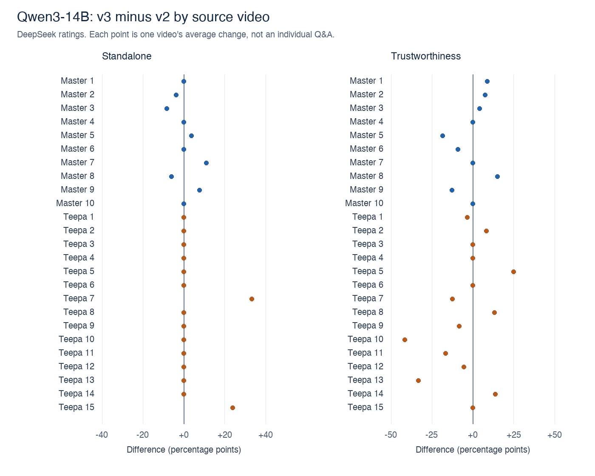

# Video-level consistency analysis

## Main finding

The two outcomes do not support a simple claim that v3 is better overall.

- **Standalone increased by 2.46 percentage points** (95% CI -0.44 to +6.04; Holm p = 0.4378). The Holm-adjusted test does not establish a difference. The estimated direction is unchanged after removing any one video. It improved on 5 videos, was unchanged on 17, and declined on 3.
- **Trustworthiness decreased by 2.63 percentage points** (95% CI -8.35 to +2.96; Holm p = 0.4378). The Holm-adjusted test does not establish a difference. The estimated direction is unchanged after removing any one video. It improved on 8 videos, was unchanged on 7, and declined on 10.

## Primary comparison

Ordinary Qwen3-14B outputs, **v3 versus v2**, judged by DeepSeek. There are **25 matched source videos: 10 Master and 15 Teepa**, with 226 Q&As in v2 and 226 in v3. Each Q&A has three saved DeepSeek ratings. Positive differences favour v3.

| Model | Judge | Outcome | v2 (%) | v3 (%) | Difference (pp) | 95% CI (pp) | Holm p | LOO range (pp) | Videos + / = / − |
| --- | --- | --- | --- | --- | --- | --- | --- | --- | --- |
| qwen3-14b | DeepSeek | Standalone | 95.05 | 97.51 | +2.46 | [-0.44, +6.04] | 0.4378 | [+1.18, +2.91] | 5 / 17 / 3 |
| qwen3-14b | DeepSeek | Trustworthiness | 88.31 | 85.68 | -2.63 | [-8.35, +2.96] | 0.4378 | [-3.78, -1.00] | 8 / 7 / 10 |

These averages can differ from earlier pooled Q&A averages because every video, rather than every Q&A, receives equal weight. The leave-one-video-out (LOO) range describes how the average changes when each video is omitted. It is **not** a confidence interval. A stable average direction does not mean every video improved. Confidence intervals are ordinary, unadjusted 95% intervals. Holm correction applies to the two primary p-values, not to these intervals.

## Supporting checks

Other judges on 14B and all judges on 7B are descriptive checks, not extra primary hypothesis tests. Every row uses the same 25 videos and 226 Q&As per version. The 7B DeepSeek data have two repeats; the other model/judge combinations have three. Judge ratings are never pooled into independent observations.

| Model | Judge | Outcome | v2 (%) | v3 (%) | Difference (pp) | 95% CI (pp) |
| --- | --- | --- | --- | --- | --- | --- |
| qwen3-14b | gpt-oss | Standalone | 98.61 | 99.39 | +0.77 | [-0.56, +2.37] |
| qwen3-14b | gpt-oss | Trustworthiness | 96.49 | 94.41 | -2.08 | [-4.61, +0.22] |
| qwen3-14b | Gemma 4 | Standalone | 94.79 | 98.37 | +3.58 | [+0.26, +7.84] |
| qwen3-14b | Gemma 4 | Trustworthiness | 89.35 | 87.45 | -1.90 | [-7.81, +3.71] |
| qwen2.5-7b | DeepSeek | Standalone | 83.19 | 83.42 | +0.23 | [-7.15, +7.33] |
| qwen2.5-7b | DeepSeek | Trustworthiness | 86.48 | 79.28 | -7.20 | [-14.65, -0.34] |
| qwen2.5-7b | gpt-oss | Standalone | 95.31 | 95.26 | -0.05 | [-4.11, +3.98] |
| qwen2.5-7b | gpt-oss | Trustworthiness | 91.56 | 92.12 | +0.55 | [-5.76, +5.88] |
| qwen2.5-7b | Gemma 4 | Standalone | 80.53 | 82.61 | +2.08 | [-7.21, +11.91] |
| qwen2.5-7b | Gemma 4 | Trustworthiness | 87.27 | 79.57 | -7.70 | [-17.60, +1.11] |

These intervals are unadjusted. Secondary judge and model comparisons are exploratory and do not replace the primary comparison.

## Analysis methods

1. Read only the run files named in the existing 14B and 7B manifests. Excluded v1, Plus, human ratings, and deliberately bad challenge examples.
2. Checked every included QA ID, question, answer, dataset, and video against its canonical Q&A file. Required complete repeated ratings, valid outcome labels, no duplicate IDs, and all 25 videos in both versions. Logged generator settings matched between v2 and v3 within each model/source collection. All 17 saved judge runs passed these checks.
3. **Standalone:** the saved Yes/No rating is positive when it is Yes. **Trustworthiness:** the saved four-level rating is positive when it is Excellent or Good. Trustworthiness here is not the separate Yes/No field, nor a mean 1–4 score.
4. Average repeats within each Q&A, Q&As within each video/version, then matched video differences. Every video has equal weight, regardless of its Q&A count. Versions are paired by source video, not by question number.
5. Resample whole paired videos **10,000 times**, with replacement within Master and Teepa, retaining 10 and 15 source videos respectively in each draw. Use the 2.5th and 97.5th percentiles of the average differences for the 95% interval. All Q&As and repeat ratings stay in their original video block. Seed is 42.
6. For the two primary outcomes, use **10,000 two-sided paired video-block label swaps** under the null assumption that version labels are exchangeable within a video. Use the plus-one Monte Carlo p-value correction and Holm adjustment across these two outcomes. Seed is 43 for label swaps.
7. Remove each video once and recalculate the remaining-video average, without changing the scoring rule. Count positive, tied, and negative per-video differences.

## Interpretation limits

- This is a **retrospective robustness analysis**, not a preregistered experiment: aggregate results had already been viewed before this plan was fixed.
- The uncertainty describes variability across these source videos, conditional on the observed generated outputs and saved judges. It does not measure variability from regenerating answers, choosing new judge models, or sampling new human annotators.
- There are 25 source-video clusters, not hundreds of independent videos. This collection is not a random sample of all dementia-care videos. Related videos or shared speakers may add dependence not captured by video-only clustering.
- These are LLM quality judgements, not independent clinical verification. Lack of a detected Trustworthiness decline is not proof that Trustworthiness is preserved.
- No generation setting beyond the recorded metadata was independently verified. Because the prompt changed as a bundle, this is not an ablation proving which instruction caused an effect.
- Human-rating analyses involving repeated annotators across videos require additional handling of annotator dependence. Human evaluation and challenge-item validation are outside the scope of this analysis.

## Files and reproducibility

- `summary.csv`: estimates, confidence intervals, primary p-values, LOO ranges, and Master/Teepa descriptive differences.
- `per_video.csv`: version means, Q&A counts, and differences for each video, model, judge, and outcome.
- `leave_one_video_out.csv`: every omitted-video result.
- `provenance.json`: exact input file names and SHA-256 hashes, recorded generator settings, validation counts, software version, repository commit, and plan/script hashes. Source file hashes were unchanged after the analysis.
- `plan.json`, `video_consistency.py`, and `test_video_consistency.py`: the fixed specification, runnable analysis, and tests. With NumPy and Pillow available, run `python3 -B video_consistency.py --repo /path/to/MedicalQA --output /path/outside/the/repository`.

The analysis reused existing generated Q&As and saved judge ratings. It did not involve new generation, judge inference, or human annotation.

## Method reference

Med-PaLM 2 kept repeated answer ratings together during clustered resampling and permutation testing. This analysis applies that dependency-preserving principle to source-video blocks. Video-level LOO and Holm correction across the two primary tests are additional methods, not methods attributed to that paper. [Singhal et al., *Toward expert-level medical question answering with large language models*, Nature Medicine (2025)](https://www.nature.com/articles/s41591-024-03423-7).
